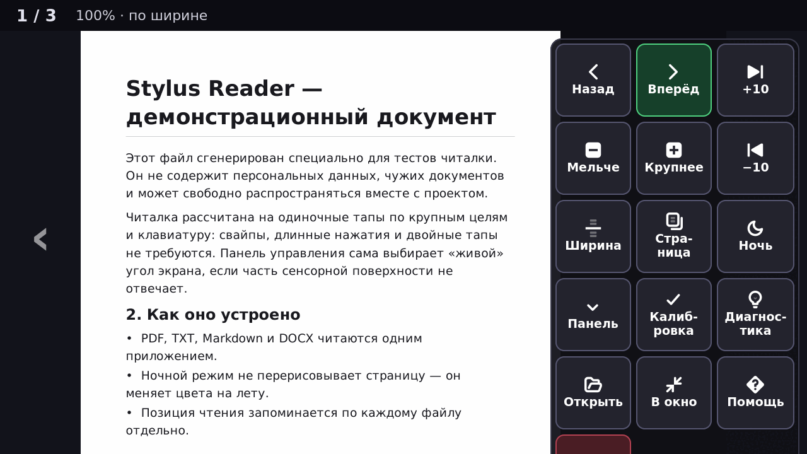
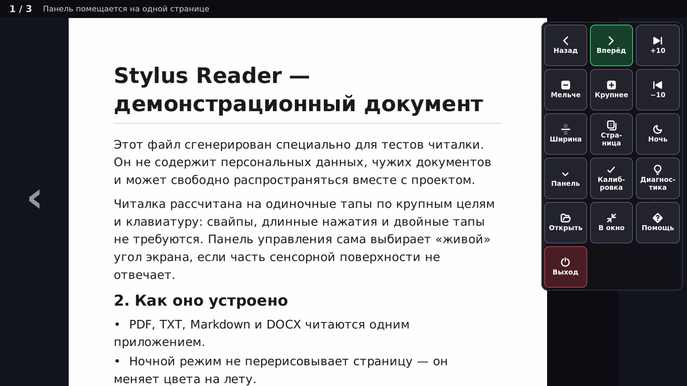
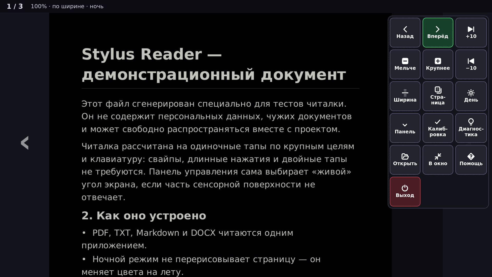
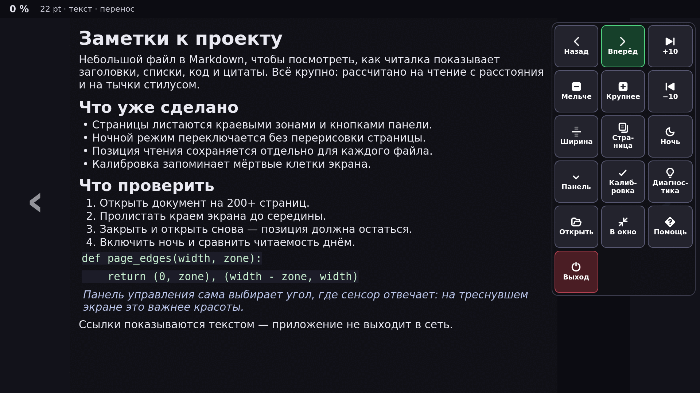

# stylus-reader


A document reader for Linux. It opens **PDF, TXT, Markdown and DOCX** and is made
for a stylus and for a **touchscreen that only partly works**: big buttons, one tap
per action, no swipes. The keyboard works everywhere.



## Why

The screen this app was written for is cracked. The touch layer still works, but
only in some places. It does not report pressure or multitouch, and the pointer
moves like a mouse cursor. Most readers want swipes and small buttons, so using
them is painful.

This reader is built around that screen:

- **One tap, big targets.** Nothing needs a gesture.
- **Dead-zone calibration.** You tap through a grid once, and the app remembers
  which cells do not answer. After that it puts the panel and the page-turn zones
  only where the touch layer works.
- **No hidden gestures.** Zoom, night mode, page turns and opening a file are all
  buttons and keys.
- **Night mode is instant.** The page is recoloured, not rendered again.

## What it can do

| | |
|---|---|
| Formats | PDF, TXT, Markdown, DOCX |
| PDF pages | a quick preview first, then a sharp page from `mutool` or `pdftoppm` |
| Reading | turn pages with the screen edges, panel buttons or keys; jump ±10 pages; zoom 0.5–3.0; fit width or whole page |
| Text files | large text (22 pt by default, 12–48): a page turn scrolls one screen, zoom changes the font size, fit turns line wrap on and off |
| Encodings | UTF-8, UTF-16, CP1251, Windows line endings |
| Night mode | recolours PDF pages without rendering them again; text gets a dark theme |
| Memory | keeps page, zoom, night mode and fit for every file; for text — how far you scrolled |
| Input report | shows what the stylus really sends: pressure, hover, drag |
| Caches | page images in memory (up to 112 MB) and on disk |
| Offline | no network calls: links in Markdown are shown as text, images as placeholders |

## Screenshots

| Second panel page | Night mode |
|---|---|
|  |  |

| Markdown | Small screen (1280×720) |
|---|---|
|  |  |

All screenshots use a demo file made by `tools/make_demo_pdf.py`.

## What you need

- Linux with GTK 4 (tested on 4.24; older versions work with fallbacks)
- Python 3.10 or newer
- PyGObject with GTK 4
- `pdfinfo` from poppler-utils (needed to read PDF info)
- `mutool` (mupdf-tools) or `pdftoppm` (poppler-utils) — at least one of them
- optional: Pillow or ImageMagick, for night mode on old GTK

Debian, Ubuntu, Kali:

```bash
sudo apt install python3-gi gir1.2-gtk-4.0 poppler-utils mupdf-tools
# optional, night mode fallback:
sudo apt install python3-pil
```

Fedora: `sudo dnf install python3-gobject gtk4 poppler-utils mupdf`

Arch: `sudo pacman -S python-gobject gtk4 poppler mupdf`

## Run

```bash
git clone https://github.com/Alisa-gh2/stylus-reader.git
cd stylus-reader

./run.sh                    # opens the last file
./run.sh book.pdf           # PDF
./run.sh notes.md           # TXT, MD or DOCX
./run.sh --windowed book.pdf  # window instead of fullscreen
```

Without the wrapper:

```bash
python3 -m stylus_reader book.pdf
python3 -m stylus_reader --help
```

The interface is in Russian. The code comments are in Russian too; this file is
in English.

## Controls

| Action | Stylus | Keyboard |
|---|---|---|
| Next / previous page | right / left edge of the screen, `Вперёд` / `Назад` | → / ←, arrows on the numeric pad, PageDown / PageUp, Space / BackSpace |
| First / last page | — | Home / End |
| ±10 pages | `+10`, `−10` | — |
| Zoom (PDF) / text size | `Крупнее`, `Мельче` | `+` / `−` |
| Fit width / whole page | `Ширина`, `Страница` | `w`, `f` |
| Night / day | `Ночь` / `День` (the label follows the state) | `n` |
| Move the panel to the next live corner | `Панель` | `p` |
| Second panel page | `Ещё` / `Меньше` | `m` |
| Calibration | `Калибровка` | `c` |
| Input report | `Диагностика` | `d` |
| Open a file | `Открыть` | Ctrl+O |
| Fullscreen | `Во весь экран` / `В окно` | F11 |
| Help | `Помощь` | F1 |
| Close help / step back | — | Esc |
| Swipe paging (off by default) | — | `s` |
| Quit | `Выход` | Ctrl+Q |

## First run

1. **Input report** (`Диагностика` or `d`). Draw on the field with the stylus, tap
   a few times, make one drag. Save the report if you want to look at it.
2. **Calibration** (`Калибровка` or `c`). The app goes fullscreen and highlights
   one cell at a time.
   - tap the highlighted cell — it is alive;
   - press **Space** if the cell does not answer — it is dead;
   - **BackSpace** goes back; save at the end.
   The map is saved in the state folder. The app uses it to place the panel, the
   page-turn zones and the action bar.
3. **Read.** Open a file and turn pages with the edges, the panel or the keys.

## Where the data lives

Everything stays on your machine, outside the repository:

- `$XDG_STATE_HOME/stylus-reader` (usually `~/.local/state/stylus-reader`)
- you can change it with `--state DIR` or `STYLUS_READER_STATE`

Inside: `positions.json` (where you stopped in each file), `calibration.json`
(dead zones), `settings.json`, `last_file.txt`, `cache/` (rendered pages) and
input reports. No telemetry, no network access.

## Tests

The self-test needs no display:

```bash
./selftest.sh                 # runs under Xvfb; exit code 0 means OK
./selftest.sh --state /tmp/st # with a state folder of your choice
```

It checks rendering, the preview-first path, cache eviction, layout and panel
placement at scale 1/2/3, text formats (UTF-8, CP1251, Markdown, DOCX), night
mode, and that the panel, the status bar, the action bar and the reading area do
not overlap.

Speed measurements:

```bash
python3 -m stylus_reader --bench
python3 -m stylus_reader --bench --bench-pdf heavy.pdf
```

## Files

```
stylus_reader/
  main.py            command line
  app.py             the GTK application and keyboard shortcuts
  reader_window.py   window, panel, navigation, rendering
  selftest.py        self-test
  bench.py           speed measurements
  render.py          PDF tools, preview and final render, caches
  textures.py        page images in memory
  layout.py          panel and zone geometry (no GTK)
  calibration.py     dead-zone map
  textdoc.py         TXT, Markdown and DOCX parsers (standard library only)
  diagnostics.py     input report
  paths.py           where state and test data live
  ui/                style, page view, calibration view, help
tools/make_demo_pdf.py    makes the demo PDF
testdata/                 files for the self-test
```

## What it does not do

- Linux only (GTK 4 with X11 or Wayland). The self-test needs `xvfb-run`.
- The interface is in Russian.
- Markdown support is a practical subset: headings, bold, italic, inline code,
  code blocks, lists, quotes, rules. Links are shown as text, images as
  placeholders. Tables, nested lists and HTML are not rendered.
- DOCX: paragraphs, headings, bold, italic, lists, line breaks, tables as
  `cell | cell` rows. Word numbering is not reproduced. The main XML part is
  limited to 20 MB.
- No search, bookmarks, notes or text-to-speech yet.

## Plans

- faster first page on a cold start
- search and bookmarks
- text-to-speech
- a dimmer overlay for reading in the dark
- an English interface

## License

MIT — see [LICENSE](LICENSE).
