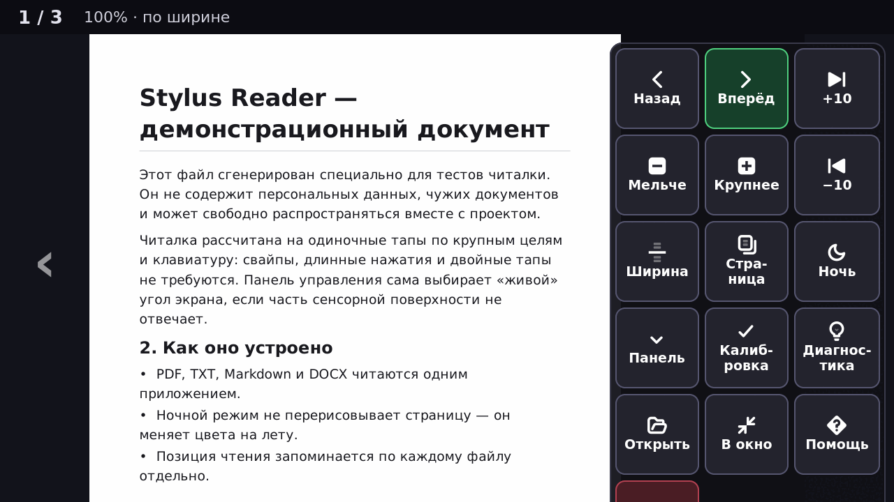
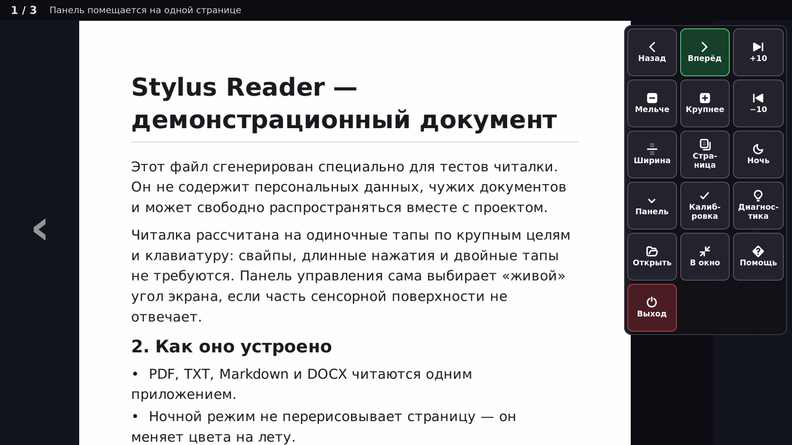
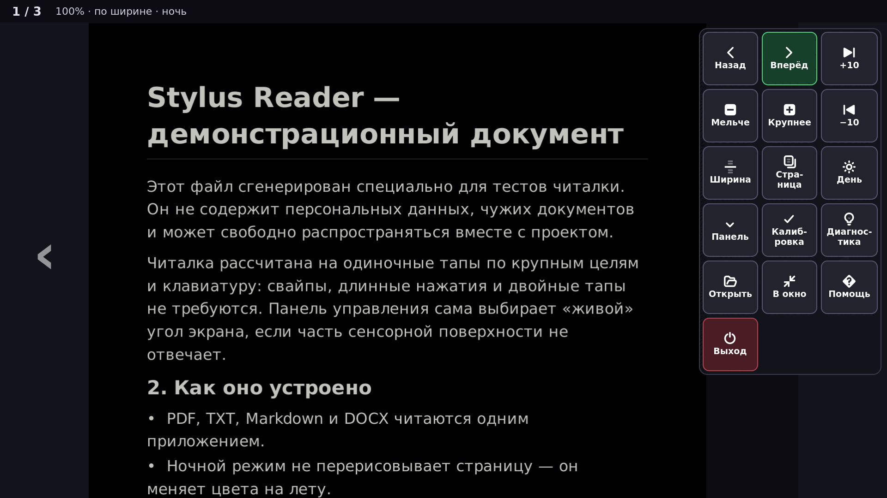
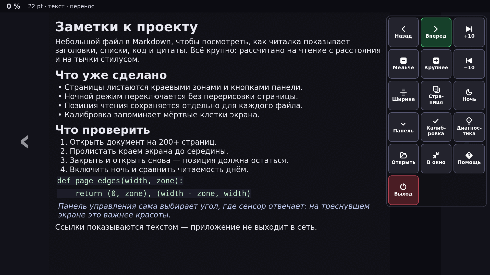

# stylus-reader


Читалка документов для Linux. Открывает **PDF, TXT, Markdown и DOCX** и рассчитана
на стилус и на **тачскрин, который работает не везде**: крупные кнопки, одно
касание на действие, свайпы не нужны. Клавиатура работает всегда.



## Зачем

Экран, для которого писалась эта читалка, треснут. Сенсорный слой ещё работает,
но только местами. Давление и мультитач он не передаёт, а указатель двигается как
курсор мыши. Обычные читалки ждут свайпов и мелких кнопок — пользоваться ими
неудобно.

Поэтому здесь всё устроено под такой экран:

- **Одно касание, крупные кнопки.** Жесты не нужны.
- **Калибровка мёртвых зон.** Один раз проходите по сетке и отмечаете клетки,
  которые не отвечают. Дальше приложение ставит панель и зоны листания только
  туда, где сенсор работает.
- **Никаких скрытых жестов.** Масштаб, ночь, листание и открытие файла — это
  кнопки и клавиши.
- **Ночь включается сразу.** Страница перекрашивается, а не рисуется заново.

## Что умеет

| | |
|---|---|
| Форматы | PDF, TXT, Markdown, DOCX |
| Страницы PDF | сначала быстрый предпросмотр, потом чёткая страница через `mutool` или `pdftoppm` |
| Чтение | листание краями экрана, кнопками панели или клавишами; переход на ±10 страниц; масштаб 0.5–3.0; по ширине или вся страница |
| Текстовые файлы | крупный текст (22 pt по умолчанию, 12–48): листание — на экран, масштаб — размер шрифта, «по ширине» — перенос строк |
| Кодировки | UTF-8, UTF-16, CP1251, переводы строк Windows |
| Ночь | перекрашивает страницы PDF без повторного рендера; для текста — тёмная тема |
| Память | хранит страницу, масштаб, ночь и вписывание для каждого файла; для текста — докуда долистали |
| Отчёт о вводе | показывает, что на самом деле передаёт стилус: давление, наведение, перетаскивание |
| Кэши | картинки страниц в памяти (до 112 МБ) и на диске |
| Без сети | ссылки в Markdown показываются текстом, картинки — заглушками |

## Скриншоты

| Вторая страница панели | Ночной режим |
|---|---|
|  |  |

| Markdown | Маленький экран (1280×720) |
|---|---|
|  |  |

Все скриншоты сняты на демо-файле из `tools/make_demo_pdf.py`.

## Что нужно

- Linux с GTK 4 (проверено на 4.24; более старые версии работают через запасные пути)
- Python 3.10 или новее
- PyGObject с GTK 4
- `pdfinfo` из poppler-utils (нужен, чтобы читать сведения о PDF)
- `mutool` (mupdf-tools) или `pdftoppm` (poppler-utils) — хотя бы одно
- по желанию: Pillow или ImageMagick, для ночи на старом GTK

Debian, Ubuntu, Kali:

```bash
sudo apt install python3-gi gir1.2-gtk-4.0 poppler-utils mupdf-tools
# по желанию, запасной ночной режим:
sudo apt install python3-pil
```

Fedora: `sudo dnf install python3-gobject gtk4 poppler-utils mupdf`

Arch: `sudo pacman -S python-gobject gtk4 poppler mupdf`

## Запуск

```bash
git clone https://github.com/Alisa-gh2/stylus-reader.git
cd stylus-reader

./run.sh                    # откроет последний файл
./run.sh книга.pdf          # PDF
./run.sh заметки.md         # TXT, MD или DOCX
./run.sh --windowed книга.pdf  # окно вместо полного экрана
```

Без обёртки:

```bash
python3 -m stylus_reader книга.pdf
python3 -m stylus_reader --help
```

Интерфейс на русском. Английская версия этого файла — `README.md`.

## Управление

| Действие | Стилус | Клавиатура |
|---|---|---|
| Вперёд / назад | правый / левый край экрана, `Вперёд` / `Назад` | → / ←, стрелки на цифровом блоке, PageDown / PageUp, Space / BackSpace |
| Первая / последняя страница | — | Home / End |
| ±10 страниц | `+10`, `−10` | — |
| Масштаб (PDF) / размер текста | `Крупнее`, `Мельче` | `+` / `−` |
| По ширине / вся страница | `Ширина`, `Страница` | `w`, `f` |
| Ночь / день | `Ночь` / `День` (подпись меняется) | `n` |
| Панель в следующий живой угол | `Панель` | `p` |
| Вторая страница панели | `Ещё` / `Меньше` | `m` |
| Калибровка | `Калибровка` | `c` |
| Отчёт о вводе | `Диагностика` | `d` |
| Открыть файл | `Открыть` | Ctrl+O |
| Полный экран | `Во весь экран` / `В окно` | F11 |
| Справка | `Помощь` | F1 |
| Закрыть справку / шаг назад | — | Esc |
| Листание свайпом (по умолчанию выкл.) | — | `s` |
| Выход | `Выход` | Ctrl+Q |

## Первый запуск

1. **Отчёт о вводе** (`Диагностика` или `d`). Проведите стилусом по полю, сделайте
   несколько касаний и одно перетаскивание. Отчёт можно сохранить и посмотреть.
2. **Калибровка** (`Калибровка` или `c`). Приложение уходит в полный экран и
   подсвечивает клетки по одной.
   - коснулись подсвеченной клетки — она живая;
   - нажали **Пробел**, если клетка не отвечает — она мёртвая;
   - **BackSpace** возвращает назад; в конце сохраните карту.
   Карта лежит в каталоге состояния. По ней приложение выбирает место для панели,
   зон листания и полосы действий.
3. **Чтение.** Откройте файл и листайте краями, панелью или клавишами.

## Где лежат данные

Всё хранится на вашей машине, вне репозитория:

- `$XDG_STATE_HOME/stylus-reader` (обычно `~/.local/state/stylus-reader`)
- можно указать своё место: `--state DIR` или `STYLUS_READER_STATE`

Внутри: `positions.json` (где вы остановились в каждом файле), `calibration.json`
(мёртвые зоны), `settings.json`, `last_file.txt`, `cache/` (отрисованные страницы)
и отчёты о вводе. Телеметрии и сетевых запросов нет.

## Тесты

Самопроверке не нужен дисплей:

```bash
./selftest.sh                 # работает под Xvfb; код возврата 0 = всё хорошо
./selftest.sh --state /tmp/st # со своим каталогом состояния
```

Проверяется рендер, быстрый предпросмотр, вытеснение кэша, раскладка и посадка
панели при scale 1/2/3, текстовые форматы (UTF-8, CP1251, Markdown, DOCX), ночной
режим и то, что панель, строка состояния, полоса действий и область чтения не
перекрываются.

Замеры скорости:

```bash
python3 -m stylus_reader --bench
python3 -m stylus_reader --bench --bench-pdf тяжёлый.pdf
```

## Файлы

```
stylus_reader/
  main.py            командная строка
  app.py             приложение GTK и горячие клавиши
  reader_window.py   окно, панель, навигация, рендер
  selftest.py        самопроверка
  bench.py           замеры скорости
  render.py          инструменты PDF, предпросмотр и финальный рендер, кэши
  textures.py        картинки страниц в памяти
  layout.py          геометрия панели и зон (без GTK)
  calibration.py     карта мёртвых зон
  textdoc.py         парсеры TXT, Markdown и DOCX (только стандартная библиотека)
  diagnostics.py     отчёт о вводе
  paths.py           где лежат состояние и тестовые данные
  ui/                стиль, страница, калибровка, справка
tools/make_demo_pdf.py    делает демо-PDF
testdata/                 файлы для самопроверки
```

## Чего пока нет

- Только Linux (GTK 4 с X11 или Wayland). Для самопроверки нужен `xvfb-run`.
- Интерфейс на русском.
- Markdown поддержан частично: заголовки, жирный, курсив, код в строке, блоки
  кода, списки, цитаты, разделители. Ссылки показываются текстом, картинки —
  заглушками. Таблицы, вложенные списки и HTML не рисуются.
- DOCX: абзацы, заголовки, жирный, курсив, списки, переносы строк, таблицы
  строками `ячейка | ячейка`. Нумерация Word не воспроизводится. Основная
  XML-часть ограничена 20 МБ.
- Пока нет поиска, закладок, заметок и синтеза речи.

## Планы

- быстрее показывать первую страницу после запуска
- поиск и закладки
- синтез речи
- затемнение поверх страницы для чтения в темноте
- английский интерфейс

## Лицензия

MIT — см. [LICENSE](LICENSE).
